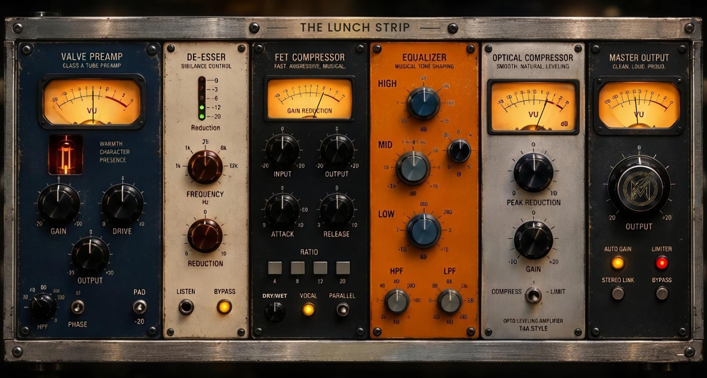
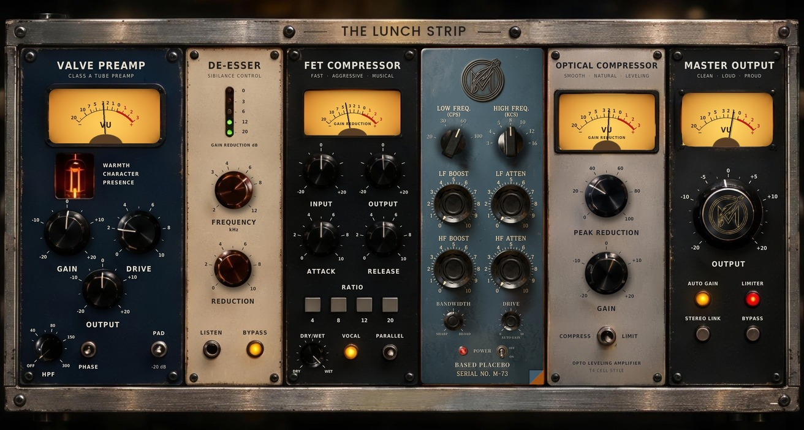
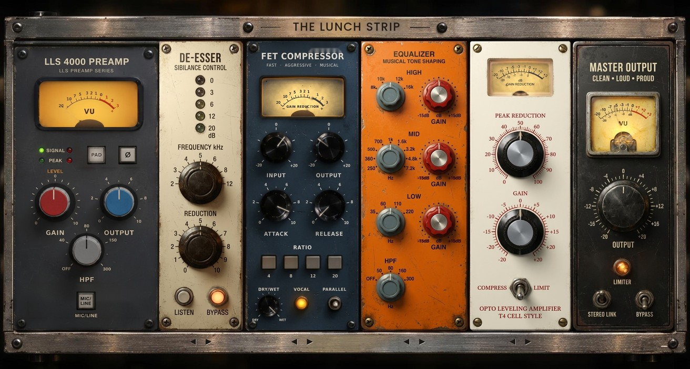
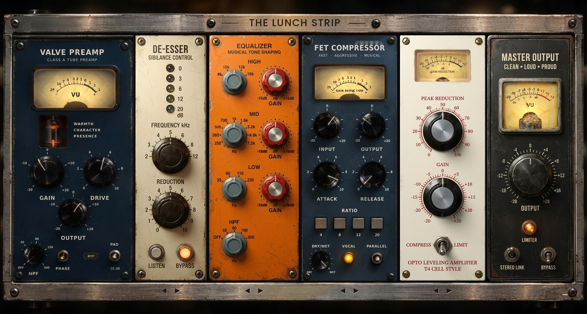

# THE LUNCH STRIP

Channel strip vocale **VST3** di **Meteora Plugins**, costruita con JUCE (CMake). Sei moduli in serie ispirati all'hardware vintage, con DSP ispirato agli algoritmi di [Airwindows](https://github.com/airwindows/airwindows) (MIT).



Interfaccia in uso (anteprima con le stesse coordinate dell'editor):


## Percorso del segnale

```
IN -> [Trasformatore: Clean / Neve] -> Valve Preamp -> De-Esser -> FET Comp (1176)
   -> Equalizer -> Opto Comp (LA-2A) -> Master Out -> OUT
```

Il **trasformatore d'ingresso** non e' un modulo: si sceglie una volta sola all'inizio (Clean o Neve 1073) e vale per tutta la catena. Il suo auto gain interno tiene lo stesso volume fra le due scelte.

Ognuno dei sei moduli ha **Bypass** e **Auto Gain**:
- bypass con crossfade di 15 ms; a fade finito il modulo non consuma CPU
- il percorso bypassato e' ritardato della latenza del modulo, quindi accendere/spegnere un modulo non sposta la fase del resto
- auto gain: misura RMS lenta (~400 ms), correzione limitata a ±12 dB, congelata in bypass e sul silenzio
- le manopole di uscita (Output del preamp e del FET, Gain dell'opto, Output del master) agiscono **dopo** l'auto gain: con AG acceso funzionano lo stesso
- auto gain di default: acceso su preamp, FET, opto e master; **spento** su de-esser ed EQ (altrimenti annullerebbe tagli e boost)

## Stato

| Modulo | DSP | Oversampling | Riferimento |
|---|---|---|---|
| Trasformatore | fatto (primo passaggio) | 4x | Neve 1073 / Airwindows Channel9, Desk4 |
| Valve Preamp | motore di **Marley** | 4x FIR fase lineare (2x da 88,2 kHz) | Airwindows Tube2 (via Marley) |
| De-Esser | fatto (split-band, shelf dinamico) | - | - |
| FET Comp | motore di **meteoraFET1179** | - | 1176 / Airwindows Logical4, Coils2, Tube2 |
| Equalizer | curve di **Meteora Winter Dreams** oppure Pultec col motore di **Placebo EQ** | - | BAE 1073D / Pultec EQP-1A (EQP-KT) |
| Opto Comp | fatto (cella T4 a doppio release) | - | LA-2A |
| Master Out | limiter soft provvisorio | - | ClipOnly2 |

La latenza dei moduli in oversampling viene sommata e dichiarata al DAW.
I motori di De-Esser, EQ e Opto stanno in `Source/DSP/DynamicsCore.h`, quello del FET in `Source/DSP/fet1179/` (tutti senza JUCE); sono verificati da `Tests/dsp_test.cpp`.

### Valve Preamp (motore Marley)
Il DSP e' quello di **Marley** (cartella `Source/DSP/marley`, copiata senza modifiche al calcolo):
oversampling 4x FIR a fase lineare → Tube2 col Drive di Marley → DC blocker 2 Hz → autogain di Marley (loudness K-pesata).

Catena del modulo: HPF → Pad / Phase / **Gain** → Marley (**Drive**, mix 100%) → auto gain della Lunch Strip → **Output**.
Il LED +48 della grafica e' stato tolto; al suo posto c'e' il pulsante **BYP** del preamp.
- **Gain**: quanto segnale entra nella valvola (piu' Gain = piu' saturazione)
- **Drive** 0..10 = Drive di Marley 0..100%; l'autogain di Marley tiene la loudness, quindi Drive cambia il carattere e non il volume
- **Output**: dopo l'auto gain

**VU del preamp** (come Marley): la lancetta legge il livello che entra nella valvola, dopo il Drive (0 VU = -8 dBFS RMS):
piu' spingi, piu' sale. Il vetro **si arrossa** con la misura di distorsione di Marley: inizia a -6 dB ed e' rosso pieno a -1 dB.
Con un seno a -18 dBFS RMS: Drive 2 → -30 dB (niente rosso), Drive 8,5 → -4 dB (rosato), Drive 10 → -2 dB (quasi pieno).
Con segnale a -6 dBFS RMS basta Drive 5 per vederlo rosato e Drive 7 per il rosso pieno.

**Valvola**: si accende quando il preamp e' attivo e il DAW manda audio (circa 2 s, curva a S), tremola appena e diventa
piu' luminosa quando satura (da -28 a -4 dB di distorsione, come in Marley); si spegne lentamente col bypass o senza audio.

### De-Esser
- **Frequenza** (2..12 kHz): il sidechain e' un passa banda su quella frequenza, quindi rileva solo le sibilanti
- la riduzione agisce con uno **shelf alto dinamico** che parte poco sotto la frequenza: a riposo e' esattamente trasparente, quando lavora abbassa solo gli acuti
- **Reduction** 0..10: 0 = spento; salendo la soglia scende (-14 → -40 dBFS) e il ratio cresce (fino a 8:1), profondita' massima -24 dB
- **Listen**: ascolti il sidechain
- il meter a LED (0 / -3 / -6 / -12 / -20) mostra la riduzione reale

### FET Comp (motore meteoraFET1179)
Il DSP e' quello di **meteoraFET1179** (cartella `Source/DSP/fet1179`, copiata senza modifiche al calcolo):
INPUT → Coils2 d'ingresso → Logical4 (FET, attack e release separati) → curva Pultec fissa + Tube2 (col suo blend) → Coils2 d'uscita.

Mappatura del pannello:
- **Input** -20..+20 dB: alza per comprimere di piu', come sul 1176
- **Attack / Release** 0..10: in senso orario piu' veloci (attack circa 50 ms → 1,5 ms, release circa 1,3 s → 60 ms)
- **Ratio** 4 / 8 / 12 / 20: i rapporti di Logical4
- **Dry/Wet** 0..100% (la manopolina in basso a sinistra, al posto di SOFT): dry/wet master di meteoraFET1179
- **Output**: make-up dopo l'auto gain
- blend Pultec + Tube2 fisso al 30% (il default di meteoraFET1179)
- HPF/LPF del sidechain di meteoraFET1179: spenti (il pannello non li ha)
- il VU mostra la gain reduction calcolata come in meteoraFET1179 (a riposo sullo 0)

**Preset** (si accendono uno alla volta; spegnendo il LED le manopole tornano come le avevi prima del preset):
- **VOCAL** (LED): Input +4 dB, Attack 5, Release 6, 4:1, Dry/Wet 100%. Su una voce intorno a -18 dBFS RMS circa 3-4 dB di riduzione (2 dB a -24, 6 dB a -12)
- **PARALLEL** (levetta): compressione molto accentuata da miscelare: "all buttons" del 1176 (i quattro tasti RATIO si accendono insieme), Input +12 dB, Attack 9, Release 8, Dry/Wet 50%. Circa 17 dB di riduzione a -18 dBFS RMS
- dopo aver caricato un preset puoi ritoccare le manopole; premendo un tasto RATIO si esce dal preset PARALLEL

### Equalizer (curve di Meteora Winter Dreams)
- **High / Low**: shelf **Baxandall del 1o ordine** di Winter Dreams (pendenza dolcissima: alla frequenza scelta c'e' meta' del guadagno) oppure campana; tasto destro sulla manopola = frequenza e Shelf/Bell
- **Mid**: campana **induttiva** di Winter Dreams, che si stringe alzando il guadagno (Q = 0,6 + 0,07 × dB); il Q del tasto destro la moltiplica (1 = esattamente Winter Dreams)
- **HPF**: "Capacitor" 18 dB/ottava di Winter Dreams (tre poli, -3 dB esatti sulla frequenza); tutto a sinistra (20 Hz) = spento
- **LPF** 12 dB/ottava (Winter Dreams non lo ha); tutto a destra (20 kHz) = spento
- valori smussati e coefficienti ricalcolati ogni 16 campioni, come in Winter Dreams: nessuno scatto

### Opto Comp (LA-2A)
- **Peak Reduction** 0..100: 0 = nessuna compressione
- detector a energia, attacco ~10 ms; release a due stadi (circa meta' in ~60 ms, il resto in 0,5..5 s) con "memoria": piu' a lungo comprimi, piu' il rilascio finale e' lento
- **Compress** ~3:1 ginocchio largo, **Limit** ~12:1
- **Gain**: make-up
- il VU mostra la **gain reduction**: a riposo la lancetta sta ferma sullo 0 e scende solo quando il compressore lavora

## Interfaccia




- **Sfondo = foto originale** (`Assets/background.jpg`), con pochi ritocchi fatti usando lettere della foto stessa,
  cosi' restano identiche alle altre: "CHARACTER" (era CHAPACTER), "AGGRESSIVE" (era ADGRESSIVE), "PROUD" (era FROUD),
  "GAIN REDUCTION" sul VU del FET (tolto il "6B", ricostruita la C). Tolti anche il LED +48 (ora BYP del preamp) e la levetta SOFT
  (ora la manopola DRY/WET). Scale, numeri e quadranti dei VU sono quelli della foto.
- **Manopole**: ruotano la texture reale; trascina in verticale, doppio click = valore di default. Le ombre sono disegnate dal codice solo sotto le manopole del Pultec.
- **VU meter**: lancette disegnate dal codice sui quadranti originali. Preamp: livello all'ingresso della valvola (come Marley).
  Master: livello d'uscita (0 VU = -18 dBFS). FET e Opto: gain reduction (a riposo sullo 0).
- **Scelta dell'EQ**: in basso a destra del pannello EQ c'e' una **linguetta** (l'angolo del pannello sollevato, che lascia
  vedere l'altro EQ sotto). Cliccandola si apre una finestrella con le anteprime: **METEORA EQ** (curve Winter Dreams) o
  **PULTEC** (basato su Placebo). Il passaggio fa una dissolvenza di 30 ms, senza scatti. Il tipo di EQ e' anche un parametro
  automatizzabile ("EQ Type") e ogni EQ tiene le sue regolazioni.
- **Pultec**: LOW FREQ e HIGH FREQ a scatti, LF BOOST, LF ATTEN, HF BOOST, HF ATTEN, BANDWIDTH, DRIVE (con autogain);
  la levetta POWER accende/spegne l'EQ (LED rosso spento quando e' spento). Con il Pultec le pillole AG/BYP dell'EQ si nascondono.
- **trasformatore Clean / Neve** sulla barra metallica, a sinistra del titolo
- **tasto destro** sulle manopole High / Mid / Low dell'EQ Meteora: popup con frequenza e Shelf/Bell (High, Low) oppure Q (Mid)
- **AG** (auto gain) e **BYP** (bypass) su ogni modulo, in alto a destra del pannello (il preamp ha BYP al posto del vecchio LED +48)
- la finestra si apre a 1600 px di larghezza e si ridimensiona mantenendo le proporzioni

Prestazioni: lo sfondo (con il pannello Pultec quando serve) viene disegnato una volta sola in un'immagine alla risoluzione reale dello schermo e
rifatta solo se cambia la misura o il tipo di EQ; lancette, valvola e LED si ridisegnano solo quando cambiano; con la
finestra nascosta il timer non lavora.

Coordinate: `Source/GuiLayout.h` (manopole), `PluginEditor.cpp` (pulsanti, meter, Pultec).

### EQ Pultec: motore Placebo EQ
Il Pultec usa il DSP di **Placebo EQ** (Meteora Plugins), copiato senza modifiche in `Source/DSP/placebo/PlaceboDSP.h`:
voicing tarato sulle misure del Klark Teknik EQP-KT, filtri "matched" (le curve alte non si schiacciano verso Nyquist),
stadio valvolare del Drive (armoniche pari, guadagno a segnale piccolo = 1, quindi non alza il volume) e trasformatore d'uscita.
Il collegamento al pannello e' `lunch::PultecCore` in `Source/DSP/DynamicsCore.h`.

Differenze rispetto al plugin Placebo, perche' il pannello della strip e' diverso:
- LOW FREQ 20 / 30 / 60 / 100 Hz (niente 200 Hz)
- ATTEN SEL fisso a 10 kHz (il default di Placebo) e niente manopola Output
- l'IN e' la levetta POWER (bypass del modulo EQ, con dissolvenza)
- default come Placebo: LOW FREQ 100 Hz, HIGH FREQ 10 kHz, BANDWIDTH 5

## Test di aliasing

`Tests/aliasing_test.cpp` (nessuna dipendenza da JUCE) prova la saturazione del trasformatore con un oversampler FIR di riferimento. Seno coerente con la FFT, armoniche vere escluse, tutto il resto e' aliasing, in dB rispetto alla fondamentale:

| Caso | senza OS | 4x |
|---|---|---|
| Trasformatore Neve, ampiezza 0,5, 6 kHz | −54 dB | **−161 dB** |

Soglia del test: meno di −70 dB col fattore usato (4x). Il preamp usa l'oversampling di Marley (FIR a fase lineare, gia' provato in Marley); il FET gira senza oversampling, esattamente come meteoraFET1179.

Limite: il test usa un filtro di riferimento, non `juce::dsp::Oversampling`. Va ripetuto sul plugin compilato (seno + analizzatore di spettro nel DAW).

```bash
cmake -B build -DBUILD_TESTS=ON
cmake --build build --target aliasing_test dsp_test
ctest --test-dir build
```

## Build

Requisiti: CMake >= 3.22, compilatore C++17 (MSVC 2022, Xcode/clang, gcc). JUCE viene scaricato da CMake.

```bash
cmake -B build -DCMAKE_BUILD_TYPE=Release
cmake --build build --config Release
```

Il VST3 e' in `build/TheLunchStrip_artefacts/.../VST3/`. Per copiarlo automaticamente nella cartella dei plugin imposta `COPY_PLUGIN_AFTER_BUILD TRUE` in `CMakeLists.txt`.

## TODO

- [ ] Test di aliasing sul plugin compilato
- [x] DSP di De-Esser, FET, EQ, Opto
- [ ] Verificare l'editor compilato (posizione dei controlli, popup EQ) e ritoccare le coordinate
- [x] Meter a LED del de-esser
- [x] Logo definitivo sulla manopola Master (`Assets/knob_master_out_cap.png`, 656 px: metallo nero satinato, logo in ottone antichizzato)
- [x] EQ: click destro sulla manopola -> popup frequenza e scelta Shelf / Bell
- [ ] Meter gain reduction con ballistica realistica
- [ ] FET: modalita' "all buttons in"

## Struttura

```
Source/
  PluginProcessor.*       catena, stato, latenza
  Parameters.*            tutti i parametri (APVTS)
  DSP/ModuleBase.h        bypass, compensazione latenza, auto gain
  DSP/DynamicsCore.h      motori di De-Esser, Opto (LA-2A) ed EQ (curve di Winter Dreams), senza JUCE
  DSP/fet1179/            motore del FET di meteoraFET1179 (Logical4, Coils2, Tube2, Pultec), senza JUCE
  DSP/Saturators.h        saturazione del trasformatore, DC blocker (senza JUCE)
  DSP/marley/             motore del preamp di Marley (Tube2, oversampling FIR, autogain), senza JUCE
  DSP/placebo/            motore dell'EQ Pultec di Placebo EQ, senza JUCE
  DSP/Biquad.h            biquad senza allocazioni
  DSP/*Module.h           un file per modulo
Source/PluginEditor.cpp   editor grafico (immagine + controlli)
Source/GuiLayout.h        coordinate delle manopole
Assets/                   sfondo e texture delle manopole (incorporati nel plugin)
Tests/aliasing_test.cpp   test offline di aliasing
Tests/dsp_test.cpp        verifica di De-Esser, FET, EQ e Opto
docs/                     mockup e anteprima
```

## Licenza

Codice sotto licenza MIT (`LICENSE`), copyright Meteora Plugins. Airwindows (MIT) e JUCE (AGPLv3 / commerciale): vedi `THIRD_PARTY_NOTICES.md`. "VST" e' un marchio di Steinberg Media Technologies GmbH.

## Modulo 1: Valve Preamp o LLS 4000 PREAMP



Nell'angolo in basso a destra del modulo 1 c'e' una linguetta: si apre la scelta fra **VALVE PREAMP** (Marley) e
**LLS 4000 PREAMP**. Il tipo e' anche un parametro ("Preamp Type"); il cambio fa una dissolvenza di 30 ms e la latenza non cambia.

LLS 4000 = stadio del banco di **Meteora DirtyDESK** col profilo "LLS" (`Source/DSP/dirtydesk`, copiato senza modifiche
al calcolo, reso solo header-only):
- **GAIN (LEVEL)** 0..10 = DRIVE del banco: come in DirtyDESK il livello e' compensato (autogain), cambia quanto satura, non il volume
- **OUTPUT** 0..10 = -15..+15 dB (5 = 0 dB), dopo l'auto gain del modulo
- **HPF** OFF / 40 / 80 / 150 / 300 Hz, **PAD** -20 dB, **fase**, **MIC/LINE** (MIC = +10 dB dentro il banco e -10 dB dopo: satura di piu')
- **VU**: livello d'uscita (0 VU = -18 dBFS); diventa **rosso** come in DirtyDESK quando il banco supera circa meta' del clip
- **LED**: SIGNAL (verde) quando c'e' segnale, PEAK (rosso) quando il banco e' spinto o l'uscita arriva a -1 dBFS
- AG e BYP del modulo sono le pillole in alto

## Moduli 2..5 scambiabili



Sotto De-Esser, FET, EQ e Opto, sulla barra metallica, ci sono due freccine: spostano il modulo a sinistra o a destra
(scambio col vicino). Cambia sia la grafica sia **l'ordine reale del suono**; lo scambio sfuma per un blocco audio, senza click.
L'ordine e' il parametro "Module Order" (0..23, le 24 permutazioni di `Source/ChainOrder.h`), non automatizzabile e salvato col progetto.

## VU: vetro e rosso

- **Vetro** su tutti i VU (Preamp/LLS 4000, FET, Opto, Master), disegnato sopra la lancetta: ombra della cornice in alto,
  riflesso curvo nella meta' alta, punto di luce, filo di luce sul bordo e due strisce di riflesso diagonali.
  Quelli di FET e Opto si spostano col loro modulo.
- **Rosso del preamp** (Valve e LLS 4000): copre tutto il quadrante ed e' la luce della lampada che diventa rossa
  (il fondo diventa rosso, numeri e scala restano scuri). Cresce da -6 dB a -1 dB di distorsione come prima.
- Nella finestrella della linguetta dell'EQ ci sono solo le immagini dei due pannelli, senza scritte.
